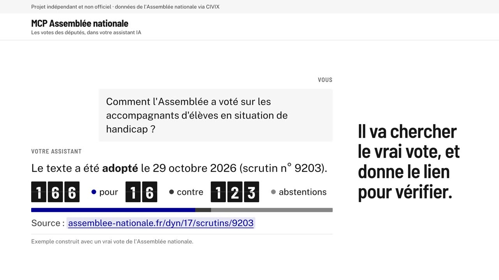
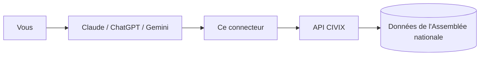

<div align="center">


# MCP Assemblée nationale

**Demandez à Claude, ChatGPT ou Gemini comment ont voté les députés.**
Gratuit, en français, avec les sources.

### [Voir la démo en direct](https://landing-page-mcp-assemblee-national.vercel.app)

[Ajouter à mon assistant](#ajouter-en-2-minutes) · [Exemples de questions](#exemples-de-questions) · [Signaler un problème](#signaler-un-problème) · [English](#english)

[](https://github.com/Toumi-Elyes/mcp-assemblee-nationale/actions/workflows/ci.yml)

[](LICENSE)
[](https://modelcontextprotocol.io)

</div>

## Voir en 25 secondes

<a href="https://github.com/Toumi-Elyes/mcp-assemblee-nationale/blob/main/web/public/video/presentation.mp4"></a>

<sub>▶ Cliquez sur l'image pour lire la vidéo. Elle montre le tableau des votes de la semaine, un exemple de réponse construit avec les données réelles du scrutin n° 9203, puis l'adresse à copier. Version verticale pour les réseaux sociaux : <a href="https://github.com/Toumi-Elyes/mcp-assemblee-nationale/blob/main/web/public/video/presentation-verticale.mp4">presentation-verticale.mp4</a>. Musique : Sascha Ende, ende.app (CC BY 4.0).</sub>

---

## C'est quoi ?

Un **connecteur** à ajouter à votre assistant IA. Il lui donne accès aux **données publiques de l'Assemblée nationale** : scrutins, députés, groupes. L'IA va chercher les vrais chiffres au lieu de répondre de mémoire, et elle cite le lien de chaque scrutin.

- **Gratuit** : pas de compte, pas de clé, pas d'abonnement à ce service.
- **En lecture seule** : l'IA consulte, elle ne modifie rien.
- **Neutre** : les chiffres sont transmis tels quels, sans analyse politique.
- **Sourcé** : chaque réponse renvoie vers la page du scrutin.

> Un connecteur, c'est un petit service que l'IA peut appeler pour trouver une information. Celui-ci repose sur MCP, un standard ouvert que Claude, ChatGPT et Gemini CLI savent utiliser.

Les données viennent de l'[API publique CIVIX](https://www.data.gouv.fr/dataservices/api-publique-civix) (data.gouv.fr), qui republie les données ouvertes de l'Assemblée nationale.

## Ajouter en 2 minutes

**1. Copiez cette adresse** (le bouton de copie apparaît en survolant le cadre) :

```
https://mcp-assemblee-nationale.vercel.app/mcp
```

**2. Collez-la dans votre assistant.** Ouvrez le bloc qui correspond au vôtre :

<details>
<summary><b>Claude</b> (claude.ai et application) : plan gratuit inclus</summary>

1. Ouvrez [claude.ai](https://claude.ai), puis **Paramètres → Connecteurs**.
2. Cliquez sur **Ajouter un connecteur personnalisé**.
3. Nom : `Assemblée nationale`. URL : collez l'adresse copiée.
4. Cliquez sur **Ajouter**. Aucune connexion n'est demandée.
5. Dans une nouvelle conversation, cliquez sur **+** (ou sur l'icône des réglages de la conversation) et vérifiez que **Assemblée nationale** est activé.

Le connecteur est ensuite disponible sur ordinateur et sur téléphone.

> Le plan gratuit autorise un connecteur personnalisé, les plans payants en autorisent plusieurs. Sur un compte Team ou Enterprise, c'est l'administrateur qui l'ajoute pour l'organisation.

</details>

<details>
<summary><b>ChatGPT</b> : plans payants, depuis le navigateur</summary>

Il faut un abonnement payant (Plus, Pro, Business, Enterprise ou Edu). Tout se fait sur **chatgpt.com**.

1. Ouvrez **Paramètres → Applications et connecteurs → Paramètres avancés** et activez le **Mode développeur**. *Selon la version, ce réglage peut aussi se trouver dans **Paramètres → Sécurité**.*
2. Revenez dans **Applications et connecteurs** et cliquez sur **Créer**.
3. Nom : `Assemblée nationale`. URL du serveur MCP : collez l'adresse copiée. Authentification : **Aucune**.
4. Cochez la case de confiance, puis validez.
5. Dans une conversation, cliquez sur **+ → Mode développeur** et activez **Assemblée nationale**.

> ChatGPT affiche « non vérifié par OpenAI » pour toute application ajoutée soi-même : c'est normal. Ce connecteur ne fait que lire des données publiques.

</details>

<details>
<summary><b>Gemini</b> : via Gemini CLI</summary>

L'application Gemini (gemini.google.com) ne permet pas, à notre connaissance, d'ajouter son propre connecteur. Dès que ce sera possible, la même adresse fonctionnera. En attendant, vous pouvez utiliser **Gemini CLI**, qui s'utilise dans un terminal :

1. Ouvrez (ou créez) le fichier `~/.gemini/settings.json`.
2. Ajoutez ce bloc :

   ```json
   {
     "mcpServers": {
       "assemblee-nationale": {
         "httpUrl": "https://mcp-assemblee-nationale.vercel.app/mcp"
       }
     }
   }
   ```

3. Relancez Gemini CLI, puis tapez `/mcp` : `assemblee-nationale` doit apparaître dans la liste.

</details>

<details>
<summary><b>Claude Desktop, Cursor et autres</b> : sur votre ordinateur</summary>

Le plus simple reste l'adresse ci-dessus : Claude Desktop reprend vos connecteurs claude.ai. Pour faire tourner le service chez vous :

1. Installez [uv](https://docs.astral.sh/uv/getting-started/installation/).
2. Collez cette configuration :

   ```json
   {
     "mcpServers": {
       "assemblee-nationale": {
         "command": "uvx",
         "args": ["--from", "git+https://github.com/Toumi-Elyes/mcp-assemblee-nationale", "mcp-assemblee-nationale"]
       }
     }
   }
   ```

3. Où la coller : **Claude Desktop** : Paramètres → Développeur → Modifier la configuration, puis redémarrez l'application. **Cursor** : `~/.cursor/mcp.json`. **Gemini CLI** : `~/.gemini/settings.json`.

</details>

<details>
<summary><b>Ça ne marche pas ?</b></summary>

**Partout**

- Le connecteur doit être **activé dans la conversation en cours** (bouton **+**). L'ajouter dans les réglages ne suffit pas.
- Demandez-le explicitement : « Utilise le connecteur Assemblée nationale pour… ». Sans cela, l'IA répond parfois de mémoire.
- Les noms des menus changent d'une version à l'autre. Si vous ne trouvez pas **Connecteurs** ou **Applications et connecteurs**, cherchez « connecteur », « MCP » ou « développeur » dans les paramètres.
- Vérifiez l'adresse : elle doit se terminer par `/mcp`, sans espace ni guillemet.

**Claude** : le plan gratuit n'autorise qu'**un seul** connecteur personnalisé. Retirez-en un autre pour ajouter celui-ci. Sur un compte d'organisation, seul l'administrateur peut en ajouter.

**ChatGPT** : il faut un plan payant et le **Mode développeur**, depuis le navigateur (pas l'application mobile). Le connecteur n'est actif que dans les conversations où vous l'avez choisi via **+ → Mode développeur**.

**Gemini** : l'application grand public ne prend pas en charge les connecteurs personnalisés, à notre connaissance. Utilisez Gemini CLI. Si `/mcp` ne liste rien, vérifiez que le texte collé est valide et relancez Gemini CLI.

**Sur votre ordinateur (uvx)** : installez [uv](https://docs.astral.sh/uv/getting-started/installation/), puis redémarrez l'application pour qu'elle retrouve la commande `uvx`.

</details>

## Exemples de questions

Posez vos questions normalement, en français.

| Votre besoin | Demandez par exemple |
|---|---|
| **Retrouver un vote** | « Quels sont les derniers scrutins sur l'immigration ? » |
| | « Retrace tous les votes sur le budget 2027. » |
| | « Quels votes se sont joués à quelques voix ce mois-ci ? » |
| **Comprendre un résultat** | « Résume-moi le scrutin sur l'aide à mourir, avec le détail par groupe. » |
| | « Qu'ont déclaré les groupes avant le vote sur [sujet] ? » |
| **Suivre un député** | « Comment a voté [nom du député] sur la loi de finances ? » |
| | « Donne-moi le bilan des votes de [député] ce mois-ci. » |
| | « [Député A] et [député B] votent-ils souvent pareil ? » |
| **Comparer les groupes** | « Quels groupes ont voté contre le dernier budget ? » |
| | « Sur les 30 derniers jours, quels groupes votent le plus souvent ensemble ? » |
| **Voir les tendances** | « Quels textes ont été le plus votés cette semaine ? » |
| | « Quelles ont été les tendances des votes ce mois-ci ? » |
| **Récupérer les données** | « Exporte en CSV les scrutins du 1er au 15 octobre. » |

Astuce : si l'IA ne trouve rien, reformulez avec un mot-clé du titre officiel (« retraites » plutôt que « la réforme de Borne »).

Chaque analyse (tendances, accords entre groupes, bilan d'un député…) se termine par un bloc **Méthode** : période, taille de l'échantillon et limites. Le serveur ne classe jamais les députés : il décrit, il ne note pas.

Six questions prêtes à l'emploi sont aussi proposées dans le menu des prompts de Claude : **Résumer un scrutin**, **Mon député**, **Comparer les groupes**, **Tendances du mois**, **Bilan d'un groupe**, **Comparer deux députés**.

### Exemple de réponse

> Illustration : le texte et les valeurs entre crochets sont inventés pour montrer la forme d'une réponse. Les vraies réponses reprennent les données de l'Assemblée.

**Vous** : Comment a voté la députée *[Prénom Nom]* sur *[sujet]* ?

**Assistant** : Sur *[sujet]*, il existe plusieurs scrutins (amendements, articles, vote sur l'ensemble du texte). Voici sa position sur chacun :

| Scrutin | Date | Position |
|---|---|---|
| *[Titre du scrutin 1]* | *[date]* | Pour |
| *[Titre du scrutin 2]* | *[date]* | Contre |

Ce sont les positions enregistrées par l'Assemblée nationale, sans interprétation.
Source : *[lien vers la page du scrutin]*

## Comment ça marche



1. Vous posez une question en français à votre assistant.
2. L'assistant appelle ce connecteur pour obtenir les scrutins, députés ou groupes concernés.
3. Le connecteur interroge CIVIX et renvoie les chiffres tels quels. L'assistant rédige la réponse et cite la source.

## Ce que l'IA peut faire

25 fonctions, rangées par besoin. Toutes sont en lecture seule et sourcées. Les analyses portent sur un échantillon limité, annoncé dans leur bloc **Méthode**. Le nom entre accents graves est celui de la fonction, utile surtout si vous voulez la demander explicitement.

### Suivre un vote

| Vous voulez… | Fonction |
|---|---|
| Chercher sans savoir si c'est un vote, un député ou un groupe | `rechercher` |
| Trouver les votes sur un thème : date, résultat, titre | `rechercher_scrutins` |
| Voir le résultat d'un vote : adopté ou rejeté, pour, contre, abstentions, détail par groupe | `obtenir_scrutin` |
| Savoir qui a voté quoi, filtré par groupe, position ou nom | `votes_scrutin` |
| Lire les explications de vote des groupes (souvent aucune) | `declarations_groupes` |
| Savoir comment UN député a voté sur un sujet, avec les sources | `comment_a_vote` |
| Suivre un texte de loi de bout en bout | `dossier_legislatif` |
| Suivre un sujet d'une législature à l'autre, depuis 2012 | `suivre_sujet` |
| Lister les scrutins entre deux dates (90 jours au plus), par type ou résultat | `scrutins_par_periode` |
| Repérer les votes récents joués à quelques voix | `votes_serres` |

### Comprendre une tendance

| Vous voulez… | Fonction |
|---|---|
| Voir le nombre de scrutins par semaine, la part de textes adoptés, les jours les plus chargés (7 à 90 jours) | `tendances_scrutins` |
| Savoir quels textes ont donné lieu au plus de scrutins | `textes_les_plus_votes` |
| Avoir les chiffres de la législature : totaux, sièges par groupe, taux d'adoption estimé | `statistiques_assemblee` |
| Voir la position majoritaire de chaque groupe sur un sujet | `positions_groupes` |
| Savoir à quelle fréquence deux groupes votent pareil | `accords_entre_groupes` |
| Mesurer la part des votes d'un groupe qui suivent sa position majoritaire | `cohesion_groupes` |

### Un député, un groupe

| Vous voulez… | Fonction |
|---|---|
| Trouver un député par nom, groupe ou législature | `rechercher_deputes` |
| Voir la fiche d'un député : groupe, circonscription, liens officiels | `obtenir_depute` |
| Connaître les groupes parlementaires : sigles, effectifs | `lister_groupes` |
| Voir la fiche d'un groupe | `obtenir_groupe` |
| Résumer les votes d'UN député et son alignement avec son groupe, avec les limites | `bilan_depute` |
| Comparer deux députés : part de votes identiques | `comparer_deputes` |

### Récupérer les données

| Vous voulez… | Fonction |
|---|---|
| Une liste de scrutins en CSV ou JSON, prête pour un tableur | `exporter_scrutins` |
| Les votes de chaque député sur un scrutin, en CSV ou JSON | `exporter_votes` |

### Pour la recherche approfondie de ChatGPT

| Vous voulez… | Fonction |
|---|---|
| Les mêmes données, dans le format attendu par la recherche approfondie de ChatGPT | `search`, `fetch` |

**Neutralité** : rien ne classe les députés ni les groupes. Les chiffres décrivent un échantillon, jamais une qualité.

## D'où viennent les données

- **Source** : les données ouvertes de l'[Assemblée nationale](https://data.assemblee-nationale.fr), mises à disposition par [CIVIX](https://www.civix.fr), une initiative indépendante, non officielle et neutre ([API sur data.gouv.fr](https://www.data.gouv.fr/dataservices/api-publique-civix)).
- **Licence des données** : Licence Ouverte Etalab 2.0.
- **Neutralité** : les chiffres sont transmis tels quels, sans analyse politique, et chaque réponse renvoie vers la source.
- **Fraîcheur** : les réponses sont gardées en mémoire 10 minutes pour ménager l'API CIVIX. Un vote du jour peut mettre un peu de temps à apparaître, selon la mise à jour des données de l'Assemblée.

Ce projet n'est affilié ni à l'Assemblée nationale, ni à CIVIX.

## Vie privée et limites

**Vie privée**

- Le connecteur ne reçoit que la recherche envoyée par l'IA (par exemple « retraites » ou un nom de député), jamais votre conversation.
- Ces mots-clés sont transmis à l'API CIVIX pour faire la recherche.
- Il n'enregistre pas les conversations, n'utilise aucun cookie et ne demande aucun compte.
- Les réponses de CIVIX (données publiques, jamais votre question) sont gardées 10 minutes, ou 24 h pour un scrutin ancien, en mémoire et dans le cache partagé de Vercel, puis oubliées.
- Votre assistant applique sa propre politique de confidentialité. L'hébergeur (Vercel) peut tenir des journaux techniques d'accès : ce code n'y écrit pas vos questions.

**Limites**

- **Assemblée nationale uniquement** : pas de Sénat, pas de Parlement européen.
- **Fraîcheur** : elle dépend de la publication des données par l'Assemblée et de leur reprise par CIVIX.
- **Disponibilité** : si CIVIX est indisponible, le connecteur le dit et il faut réessayer plus tard.
- **Couverture** : les scrutins et les votes nominatifs sont disponibles de la 14e législature (2012) à la 17e (en cours). Les députés des 14e, 15e et 16e législatures viennent d'un index tiré des données ouvertes de l'Assemblée nationale, embarqué dans le connecteur. Pour les 14e et 15e législatures, CIVIX ne fournit ni le titre, ni le résultat officiel, ni le décompte par groupe des scrutins : le connecteur les reprend des archives de scrutins de l'Assemblée, embarquées elles aussi, et la recherche par mots-clés y porte sur ces titres. Pour 710 scrutins de juillet 2012 à février 2014, l'Assemblée n'a publié que les noms des députés ayant voté autrement que leur groupe : le connecteur le signale et les écarte des analyses de députés. Rien n'est disponible avant 2012.
- **Plusieurs scrutins par texte** : un texte donne souvent plusieurs votes (amendements, articles, ensemble). Vérifiez toujours lequel est cité.

## Sécurité

Le connecteur est en lecture seule et sans compte. Il est protégé ainsi :

- **Plafond de requêtes et délai maximal** : chaque question est limitée en nombre de requêtes vers CIVIX (de 10 pour une recherche simple à 45 pour une analyse, les réponses déjà en mémoire ne comptent pas) et en durée. Au-delà, il répond par exemple « Demande trop large : précisez le nom, le groupe ou le sujet ».
- **Protection contre les abus** : des règles de limitation de débit sont appliquées sur le pare-feu de Vercel.
- **Citations signalées** : les déclarations des groupes sont citées telles quelles et marquées comme texte de tiers, pas comme consignes.
- **Liens contrôlés** : seuls les liens https vers `civix.fr`, `assemblee-nationale.fr` et `data.assemblee-nationale.fr` sont repris.

Vous avez trouvé une faille ? Ne l'ouvrez pas en issue publique : suivez [SECURITY.md](SECURITY.md).

## Signaler un problème

Vous avez repéré un bug, une donnée qui semble fausse, ou vous avez une idée ? Ouvrez une issue avec le formulaire qui correspond : il pose les bonnes questions et range automatiquement votre signalement dans le [tableau du projet](https://github.com/users/Toumi-Elyes/projects/3). Il faut un compte GitHub (gratuit).

| Vous voulez… | Formulaire |
|---|---|
| Signaler un bug (le connecteur ou la page ne marche pas comme prévu) | [Signaler un bug](https://github.com/Toumi-Elyes/mcp-assemblee-nationale/issues/new?template=bug.yml) |
| Signaler une donnée incorrecte (un vote, un député ou un chiffre différent de la source officielle) | [Signaler une donnée incorrecte](https://github.com/Toumi-Elyes/mcp-assemblee-nationale/issues/new?template=donnees.yml) |
| Proposer une amélioration (une question à couvrir, un nouvel outil, une idée pour la page) | [Proposer une amélioration](https://github.com/Toumi-Elyes/mcp-assemblee-nationale/issues/new?template=amelioration.yml) |

Pour que l'on puisse vous aider vite :

1. Indiquez la question posée à votre assistant et la réponse obtenue (une capture suffit).
2. Pour une donnée, ajoutez le lien vers la page officielle du scrutin sur assemblee-nationale.fr.
3. Retirez toute information personnelle avant de publier : les issues sont publiques.

Une faille de sécurité ne se signale **pas** en issue publique : utilisez le [signalement privé](https://github.com/Toumi-Elyes/mcp-assemblee-nationale/security/advisories/new) (voir [SECURITY.md](SECURITY.md)).

## Questions fréquentes

<details>
<summary>Est-ce gratuit ?</summary>

Oui. Le connecteur, l'API CIVIX et l'hébergement sont gratuits. Seul l'abonnement à votre assistant (ChatGPT par exemple) peut être payant.

</details>

<details>
<summary>Est-ce officiel ?</summary>

Non. C'est un projet personnel, indépendant de l'Assemblée nationale. Les données viennent de l'Assemblée, via CIVIX, qui est lui aussi indépendant.

</details>

<details>
<summary>Mes conversations sont-elles enregistrées ?</summary>

Le connecteur ne reçoit que la recherche envoyée par l'IA, jamais votre conversation. Il ne garde aucun historique et n'utilise aucun cookie. Voir [Vie privée et limites](#vie-privée-et-limites).

</details>

<details>
<summary>L'IA dit qu'elle n'a pas accès au connecteur</summary>

Vérifiez que le connecteur est activé dans la conversation (bouton **+**), puis demandez explicitement : « Utilise le connecteur Assemblée nationale pour… ».

</details>

<details>
<summary>J'ai un message d'erreur</summary>

- « Le service CIVIX est momentanément indisponible » : réessayez dans quelques minutes.
- « Aucune donnée trouvée » : l'identifiant ou le nom est inconnu. Reformulez.
- « Demande trop large » : précisez le nom, le groupe ou le sujet.

</details>

<details>
<summary>L'IA s'est trompée</summary>

Ouvrez le lien « Source » de la réponse : il mène à la page du scrutin. Les chiffres viennent du connecteur, mais c'est l'IA qui rédige la phrase : elle peut mal les résumer.

</details>

<details>
<summary>Comment signaler une erreur ?</summary>

- *Les données elles-mêmes semblent fausses* (vote ou député mal enregistré) : utilisez le formulaire [Signaler une donnée incorrecte](https://github.com/Toumi-Elyes/mcp-assemblee-nationale/issues/new?template=donnees.yml) ; nous transmettrons à CIVIX si l'erreur vient de la source.
- *Le connecteur se comporte mal* (erreur, réponse mal formée) : utilisez le formulaire [Signaler un bug](https://github.com/Toumi-Elyes/mcp-assemblee-nationale/issues/new?template=bug.yml) (voir [Signaler un problème](#signaler-un-problème)).
- *Une faille de sécurité* : voir [SECURITY.md](SECURITY.md).

</details>

<details>
<summary>Et le Sénat ?</summary>

Pas pour l'instant : l'API CIVIX couvre uniquement l'Assemblée nationale.

</details>

## Pour les développeurs

Serveur [MCP](https://modelcontextprotocol.io) en Python, construit avec [FastMCP](https://gofastmcp.com) 4. Les réponses de l'API CIVIX sont validées par des modèles [Pydantic](https://docs.pydantic.dev) v2, les appels passent par [httpx](https://www.python-httpx.org), et les dépendances sont gérées avec [Poetry](https://python-poetry.org). Il faut Python 3.14 ou plus récent (développé en 3.15).

<details>
<summary><b>Lancer en local et vérifier</b></summary>

```bash
poetry install
poetry run mcp-assemblee-nationale                    # stdio
poetry run mcp-assemblee-nationale --http --port 8000 # HTTP sur http://127.0.0.1:8000/mcp
npx @modelcontextprotocol/inspector poetry run mcp-assemblee-nationale  # tester les outils
```

Options : `--http` (HTTP streamable sans état, chemin `/mcp`), `--host` (défaut `127.0.0.1`, ou variable `HOST`), `--port` (défaut `8000`, ou variable `PORT`). Sans `--http`, le serveur parle en stdio.

```bash
poetry run ruff check . && poetry run ruff format --check .
poetry run mypy src tests api
poetry run pytest                          # tests hors ligne, sur des réponses CIVIX enregistrées
CIVIX_LIVE=1 poetry run pytest tests/live  # tests contre la vraie API CIVIX
```

Les réponses enregistrées sont dans `tests/fixtures/`, avec la spécification OpenAPI de CIVIX (`civix-openapi.json`).

</details>

<details>
<summary><b>Architecture</b></summary>

```
src/assemblee_mcp/
├── civix/            client HTTP async de l'API CIVIX : caches, budget d'appels, erreurs en français
│   └── models/       modèles Pydantic des réponses CIVIX (enveloppe, scrutins, députés, groupes)
├── analytics/        analyses pures : échantillons (gather), calculs (stats/), rendu avec bloc « Méthode » (render/), exports CSV/JSON
├── tools/            outils MCP, une classe par famille d'outils (ToolSet) ; analyses/ regroupe les outils de tendance
├── formatting/       mise en forme des réponses en français (scrutins, votes, députés, déclarations, sources)
├── limits.py         budgets, délais, tailles de page et plafonds de période, chacun commenté
├── prompts.py        questions prêtes à l'emploi
├── config.py         réglages lus dans les variables d'environnement
├── server.py         assemble le serveur (`mcp`) et la route /health
├── __main__.py       lancement en stdio ou en HTTP
└── README.md         plan détaillé du code et parcours d'une requête
api/index.py          point d'entrée Vercel (ASGI)
web/                  page de démo (Next.js)
```

</details>

<details>
<summary><b>Modèles Pydantic</b></summary>

Fichier `src/assemblee_mcp/civix/models.py`. Tous héritent de `CivixModel` : champs inconnus ignorés, modèles immuables.

- **Enveloppe générique** `CivixResponse[AttributesT]` : `answer`, `summary`, `canonical_url`, `meta` (avec `Pagination`), `source`, `citation` et `data` (`Data[AttributesT]`, dont le bloc `attributes`).
- **Modèles par point d'accès**, en alias : `ScrutinListResponse`, `ScrutinResponse`, `ScrutinVotesResponse`, `StatementsResponse`, `DeputeListResponse`, `DeputeDetailResponse`, `GroupeListResponse`, `GroupeDetailResponse`, `SearchResponse`.
- **Objets métier** : `ScrutinSummary`, `ScrutinDetail`, `Scrutin`, `Vote`, `VoteCounts`, `GroupVoteCounts`, `Depute`, `Groupe`, `GroupeStatement`, et les résultats de recherche (`DeputeSearchHit`, `ScrutinSearchHit`, `GroupeSearchHit`, `DossierSearchHit`).
- **`Position`** : `StrEnum` (`pour`, `contre`, `abstention`, `non_votant`, `unknown`). Toute valeur inconnue devient `unknown`.

Une réponse qui ne respecte pas le modèle devient un message d'erreur lisible, jamais une trace d'appel.

</details>

<details>
<summary><b>Référence des outils (paramètres)</b></summary>

Tous les outils sont annotés `readOnlyHint`, `idempotentHint` et `openWorldHint` à vrai, `destructiveHint` à faux. Ils renvoient du markdown français, sauf `search` et `fetch` qui renvoient du JSON. Une erreur CIVIX devient une `ToolError` au message clair. Taille de page par défaut : 10 (20 pour `scrutins_par_periode`).

Budgets par appel d'outil (`limits.py`) : nombre maximal d'appels réseau vers CIVIX (les réponses en cache ne comptent pas) et délai maximal. Dépassement : message d'erreur en français, jamais de trace d'appel.

| Famille | Appels CIVIX max | Délai max | Outils |
|---|---|---|---|
| Recherche et fiches | 10 | 25 s | `rechercher`, `rechercher_scrutins`, `obtenir_scrutin`, `votes_scrutin`, `declarations_groupes`, `obtenir_depute`, `comment_a_vote`, `lister_groupes`, `obtenir_groupe`, `search`, `fetch` |
| Annuaire | 20 | 25 s | `rechercher_deputes` |
| Analyses sur listes | 30 | 45 s | `tendances_scrutins`, `textes_les_plus_votes`, `dossier_legislatif`, `suivre_sujet`, `scrutins_par_periode`, `statistiques_assemblee`, `exporter_scrutins`, `exporter_votes` |
| Analyses sur détails de scrutins | 45 | 45 s | `positions_groupes`, `accords_entre_groupes`, `cohesion_groupes`, `votes_serres`, `bilan_depute`, `comparer_deputes` |

Types partagés : `page` entier de 1 à 500 (défaut `1`) ; `legislature` entier de 1 à 30 ; `uid` de scrutin : 3 à 64 caractères `[A-Za-z0-9_-]` ; `groupe` / `abbr` : sigle de 1 à 32 caractères ; `position` : `pour`, `contre`, `abstention` ou `non_votant` ; `type_scrutin` / `type` : `tous`, `texte`, `article`, `amendement` ou `autre` ; dates au format `AAAA-MM-JJ` ; `dossier` : référence `DLR…` (3 à 30 caractères alphanumériques après `DLR`).

| Outil | Paramètres (type, défaut) | Rôle |
|---|---|---|
| `rechercher` | `requete: str` (2 à 200 car., requis), `page: int = 1` | Recherche globale ; jusqu'à 8 résultats par catégorie |
| `rechercher_scrutins` | `mots_cles: str \| None = None` (max 200), `legislature: int \| None = None`, `page: int = 1` | Scrutins par sujet ; sans mots-clés, les plus récents |
| `obtenir_scrutin` | `uid: str` (requis) | Détail et décomptes, global et par groupe |
| `votes_scrutin` | `uid: str` (requis), `groupe: str \| None = None`, `position: "pour" \| "contre" \| "abstention" \| "non_votant" \| None = None`, `nom: str \| None = None` (max 100) | Votes individuels ; liste limitée à 60 noms, totaux officiels toujours indiqués ; pour une législature close, `groupe` désigne le groupe des députés à la date du scrutin |
| `declarations_groupes` | `uid: str` (requis) | Explications de vote publiées par les groupes |
| `rechercher_deputes` | `nom: str \| None = None` (max 100), `groupe: str \| None = None`, `legislature: int \| None = None` (17 par défaut, 14 à 17), `page: int = 1` | Députés par nom, groupe ou législature |
| `obtenir_depute` | `uid: str` (3 à 32 car. alphanumériques) ou `nom: str`, `legislature: int \| None = None` | Fiche d'un député ; un ancien député est retrouvé par son `uid` dans sa législature la plus récente |
| `comment_a_vote` | `depute: str` (2 à 100 car., requis), `sujet: str \| None = None` (max 200), `scrutin_uid: str \| None = None`, `legislature: int \| None = None` | Position d'un député ; exactement un de `sujet` ou `scrutin_uid` ; jusqu'à 5 scrutins ; nom ambigu : jusqu'à 10 candidats ; la législature se déduit de `scrutin_uid` |
| `lister_groupes` | aucun | Groupes, sigles et effectifs |
| `obtenir_groupe` | `abbr: str` (requis) | Fiche d'un groupe |
| `search` | `query: str` (2 à 200 car., requis) | JSON `{"results": [{"id", "title", "url"}]}` ; ids `scrutin:<uid>`, `depute:<uid>`, `groupe:<sigle>`, `dossier:<DLR…>` |
| `fetch` | `id: str` (3 à 100 car., requis) | JSON `{"id", "title", "text", "url", "metadata"}` pour un id renvoyé par `search` ; un `dossier:<DLR…>` donne la chronologie de ses scrutins |
| `dossier_legislatif` | `texte: str` (2 à 200 car., requis ; mots-clés ou référence `DLR…`) | Chronologie des scrutins d'un texte ; amendements comptés mais non listés ; si plusieurs dossiers correspondent, le plus voté est détaillé |
| `suivre_sujet` | `sujet: str` (2 à 200 car., requis) | Par législature, de la 14e à la 17e : scrutins dont le titre correspond, nature, adoptés et rejetés, derniers votes sur l'ensemble ; 100 scrutins lus au plus par législature |
| `scrutins_par_periode` | `date_debut: str` (requis), `date_fin: str` (requis, 90 jours au plus), `type: str = "tous"`, `resultat: "adopte" \| "rejete" \| "tous" = "tous"`, `page: int = 1` (1 à 100) | 20 scrutins par page, du plus récent au plus ancien |
| `votes_serres` | `periode_jours: int = 30` (7 à 30), `max_scrutins: int = 30` (3 à 30), `ecart_max: int = 20` (0 à 100 voix), `type_scrutin: str = "texte"` | Scrutins dont l'écart entre pour et contre est faible |
| `tendances_scrutins` | `periode_jours: int = 30` (7 à 90), `legislature: int \| None = None` | Volume par semaine, taux d'adoption par type et contexte, jours les plus chargés ; pour une législature close, la période finit à son dernier scrutin |
| `textes_les_plus_votes` | `periode_jours: int = 30` (7 à 90), `limite: int = 10` (1 à 30) | Dossiers classés par nombre de scrutins ; ce nombre reflète surtout celui des amendements |
| `statistiques_assemblee` | aucun | Totaux de la législature en cours, effectifs par groupe, taux d'adoption estimé sur un échantillon |
| `positions_groupes` | `sujet: str \| None = None`, `dossier: str \| None = None` (un seul des deux), `max_scrutins: int = 15` (3 à 30), `type_scrutin: str = "tous"`, `legislature: int \| None = None` (14 à 17) | Position majoritaire de chaque groupe, scrutin par scrutin |
| `accords_entre_groupes` | `sujet: str \| None = None`, `periode_jours: int \| None = None` (7 à 30), `max_scrutins: int = 30` (3 à 30), `type_scrutin: str = "tous"`, `legislature: int \| None = None` (14 à 17) | Taux d'accord entre groupes, deux à deux ; un seul de `sujet` ou `periode_jours` |
| `cohesion_groupes` | `sujet: str \| None = None`, `periode_jours: int \| None = None` (7 à 30), `max_scrutins: int = 30` (3 à 30), `type_scrutin: str = "tous"`, `legislature: int \| None = None` (14 à 17) | Part des votes conformes à la position majoritaire du groupe ; un seul de `sujet` ou `periode_jours` |
| `bilan_depute` | `depute: str` (2 à 100 car., requis), `sujet: str \| None = None`, `periode_jours: int \| None = None` (7 à 30), `max_scrutins: int = 30` (3 à 30), `legislature: int \| None = None` | Répartition des positions d'UN député et alignement sur son groupe ; un seul de `sujet` ou `periode_jours` ; pour une législature close, la période finit à son dernier scrutin |
| `comparer_deputes` | `depute_a: str` (requis), `depute_b: str` (requis), `sujet: str \| None = None`, `periode_jours: int \| None = None` (7 à 30), `max_scrutins: int = 30` (3 à 30), `legislature: int \| None = None` | Part de positions identiques sur les scrutins où les deux ont voté ; un seul de `sujet` ou `periode_jours` |
| `exporter_scrutins` | `date_debut: str \| None = None`, `date_fin: str \| None = None` (90 jours au plus), `sujet: str \| None = None` (max 200), `format: "csv" \| "json" = "csv"`, `max_lignes: int = 500` (1 à 1000) | Export de scrutins ; par sujet, 100 scrutins au plus ; les cellules CSV commençant par `=`, `+`, `-` ou `@` sont neutralisées |
| `exporter_votes` | `scrutin_uid: str` (requis), `format: "csv" \| "json" = "csv"` | Votes nominatifs d'un scrutin |


Prompts MCP (`src/assemblee_mcp/prompts.py`) :

| Prompt | Paramètre | Enchaînement demandé à l'IA |
|---|---|---|
| `resumer_scrutin` | `sujet: str` | `rechercher_scrutins` puis `obtenir_scrutin` |
| `mon_depute` | `nom: str` | `rechercher_deputes` puis `obtenir_depute`, puis propose `comment_a_vote` |
| `comparer_groupes` | `sujet: str` | `rechercher_scrutins`, `obtenir_scrutin` et `declarations_groupes` |
| `tendances_du_mois` | aucun | `tendances_scrutins` puis `textes_les_plus_votes` (30 derniers jours) |
| `bilan_groupe` | `groupe: str` (sigle) | `obtenir_groupe`, `cohesion_groupes` et `accords_entre_groupes` (30 derniers jours) |
| `comparer_deux_deputes` | `depute_a: str`, `depute_b: str` | `comparer_deputes` (sujet au choix ou 30 derniers jours) |

Le serveur expose aussi `GET /health`, qui répond `{"status": "ok"}`.

</details>

<details>
<summary><b>Réglages (variables d'environnement)</b></summary>

| Variable | Défaut | Rôle |
|---|---|---|
| `CIVIX_BASE_URL` | `https://www.civix.fr/api/v1` | Adresse de l'API |
| `CIVIX_TIMEOUT` | `10` | Délai max d'un appel, en secondes |
| `CIVIX_CACHE_TTL` | `600` | Durée du cache, en secondes |
| `CIVIX_CACHE_MAX_ENTRIES` | `500` | Nombre max de réponses gardées en cache |
| `CIVIX_USER_AGENT` | `mcp-assemblee-nationale (+https://github.com/Toumi-Elyes/mcp-assemblee-nationale)` | En-tête `User-Agent` envoyé à CIVIX |
| `CIVIX_SHARED_CACHE` | actif sur Vercel | `off` coupe le cache partagé entre instances (Runtime Cache de Vercel) |
| `HOST` | `127.0.0.1` | Hôte d'écoute en mode `--http` |
| `PORT` | `8000` | Port d'écoute en mode `--http` |

En cas d'échec réseau ou d'erreur 5xx, le client refait un seul essai après 0,3 s. Il limite aussi les appels simultanés vers CIVIX (4 au maximum).

Caches : réponses gardées `CIVIX_CACHE_TTL` secondes (10 minutes par défaut). Le détail et les votes d'un scrutin vieux de plus de 2 jours, qui ne change plus, sont gardés 24 h. Ces durées et les tailles des caches de votes et de détails ne sont pas réglables par variable d'environnement.

Deux niveaux de cache, lus dans cet ordre :

| Niveau | Où | Durées | Rôle |
|---|---|---|---|
| L1 | mémoire de chaque instance (`civix/cache.py`, LRU) | listes et recherches 10 min ; détail et votes d'un scrutin de plus de 2 jours, annuaire des députés : 24 h | réponse immédiate, aucune copie sérialisée |
| L2 | [Runtime Cache de Vercel](https://vercel.com/docs/runtime-cache) (`civix/shared_cache.py`) | mêmes durées qu'en L1 | une instance froide relit L2 au lieu de CIVIX ; persistant entre instances et déploiements |

Lecture : L1, puis L2 si L1 est vide, puis CIVIX ; une réponse venue de CIVIX est écrite dans L1 et dans L2. Une réponse lue dans L2 ne coûte aucun appel du budget, comme en L1. Précautions :

- L2 n'existe que sur Vercel (variables `RUNTIME_CACHE_ENDPOINT` et `RUNTIME_CACHE_HEADERS` posées par la plateforme) ; ailleurs, il est inactif. `CIVIX_SHARED_CACHE=off` le coupe.
- Une panne ou un délai (2 s) de L2 n'échoue jamais une demande : on lit CIVIX, et L2 est ignoré 60 s.
- Les clés sont préfixées par `SHARED_CACHE_SCHEMA_VERSION` (`limits.py`) : le changer après une modification de modèle ignore toutes les anciennes entrées. Une entrée de forme ancienne est aussi ignorée à la lecture.
- Chaque élément porte les étiquettes `civix` et `civix:<ressource>` (`scrutin-detail`, `scrutin-votes`, `scrutins`, `deputes`, `directory`…) pour une expiration ciblée.
- Un élément de plus de 2 Mo (limite du Runtime Cache) reste en mémoire seule. En pratique : l'annuaire fait environ 260 Ko, une liste de 50 scrutins 50 Ko, les votes d'un scrutin 45 Ko.
- Le SDK `vercel-cache` envoie de la télémétrie à Vercel ; elle est coupée par défaut (`VERCEL_TELEMETRY_DISABLED=1`, sauf si vous la définissez autrement).

</details>

<details>
<summary><b>Héberger votre propre copie</b></summary>

Le serveur public tourne sur [Vercel](https://vercel.com) (région de Paris, `cdg1`), gratuitement (plan Hobby) et sans compte à créer pour les utilisateurs. Le dépôt contient déjà tout le nécessaire : `api/index.py` expose l'application ASGI sur `/mcp` et `vercel.json` y redirige toutes les requêtes.

1. Forkez ce dépôt et importez-le dans Vercel (**Add New → Project**). Gardez la racine du dépôt comme dossier racine et laissez le framework sur **Other**.
2. Déployez. Vercel lit les dépendances et la version de Python dans `pyproject.toml`.
3. Votre adresse à partager est `https://<votre-projet>.vercel.app/mcp`. Vérifiez avec `https://<votre-projet>.vercel.app/health`.
4. Ajoutez une limitation de débit sur le pare-feu de votre projet : le code limite le nombre d'appels vers CIVIX par demande, pas le nombre de demandes.

Pour votre propre copie, chaque push sur votre branche principale redéploie le serveur.

Pour un autre hébergeur (Render, Fly.io, un VPS…) :

```bash
mcp-assemblee-nationale --http --host 0.0.0.0 --port $PORT
```

</details>

## Contribuer

Les issues et pull requests sont les bienvenues : nouvelle fonction, meilleure formulation des réponses, correction. La branche `main` est protégée : toute contribution passe par une pull request dont la CI est verte. Voir [CONTRIBUTING.md](CONTRIBUTING.md).

Une règle : **des faits sourcés, aucune interprétation politique**.

## Crédits et licences

- Données : [Assemblée nationale](https://data.assemblee-nationale.fr), en open data, sous Licence Ouverte Etalab 2.0.
- API : [CIVIX](https://www.civix.fr), par Arnaud Bergeret, référencée sur [data.gouv.fr](https://www.data.gouv.fr/dataservices/api-publique-civix). CIVIX est une initiative indépendante et non officielle.
- Outils : [FastMCP](https://gofastmcp.com), [Pydantic](https://docs.pydantic.dev), [httpx](https://www.python-httpx.org).
- Code : licence [MIT](LICENSE), © Elyes Toumi. Données : Licence Ouverte Etalab 2.0.

## English

A connector (an [MCP](https://modelcontextprotocol.io) server) that lets Claude, ChatGPT or Gemini answer questions about **French National Assembly votes**, using the open [CIVIX API](https://www.data.gouv.fr/dataservices/api-publique-civix). Free, no account, read-only, every answer links its source.

- **Live demo**: [landing page](https://landing-page-mcp-assemblee-national.vercel.app)
- **Remote URL** (Claude custom connectors, ChatGPT developer mode, Gemini CLI `httpUrl`): `https://mcp-assemblee-nationale.vercel.app/mcp`
- **Local**: `uvx --from git+https://github.com/Toumi-Elyes/mcp-assemblee-nationale mcp-assemblee-nationale` (stdio), or `--http` for streamable HTTP.
- **Tools**: 25 read-only tools and 6 prompts (vote tracking, trends, group agreement and cohesion, per-deputy summary, CSV/JSON exports). Every analysis ends with a « Méthode » block (period, sample, limits) and nothing ranks deputies. Outputs are in French.
- **Scope**: National Assembly only (no Senate).
- **Privacy**: only the tool query is received; no conversation history, no cookies; CIVIX responses are cached for 10 minutes (24 h for settled votes), in memory and in Vercel's shared Runtime Cache.
- **Security**: per-call CIVIX request cap, rate limiting at the hosting firewall, third-party text quoted and marked, links allow-listed. Report vulnerabilities via [SECURITY.md](SECURITY.md).
- **Stack**: Python 3.14+, FastMCP 4, Pydantic v2, httpx, Poetry, hosted on Vercel (Paris).
- **Not official**: independent project, not affiliated with the Assemblée nationale or CIVIX.
- **Licence**: code under [MIT](LICENSE); data under Licence Ouverte Etalab 2.0.
- **Bug reports**: use the [issue forms](https://github.com/Toumi-Elyes/mcp-assemblee-nationale/issues/new/choose) (bug, incorrect data, idea); security issues go through [private reporting](https://github.com/Toumi-Elyes/mcp-assemblee-nationale/security/advisories/new).
