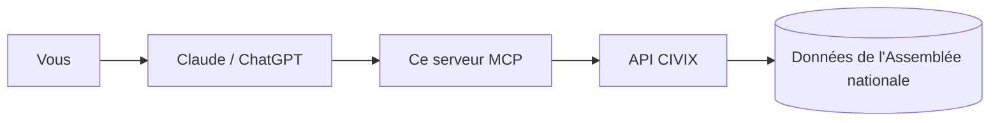

# 🏛️ MCP Assemblée nationale

**Demandez à Claude, ChatGPT ou Gemini comment ont voté les députés, en français, avec les sources.**

[](https://github.com/Toumi-Elyes/mcp-assemblee-nationale/actions/workflows/ci.yml)

[](LICENSE)
[](https://modelcontextprotocol.io)

> « Comment a voté ma députée sur la réforme des retraites ? »
> « Quels groupes ont voté contre le dernier budget ? »
> « Résume-moi le scrutin sur l'aide à mourir, avec le détail par groupe. »

Ce projet branche votre assistant IA sur les **données publiques de l'Assemblée nationale**, via l'[API publique CIVIX](https://www.data.gouv.fr/dataservices/api-publique-civix) référencée sur data.gouv.fr. L'IA va chercher les vrais chiffres au lieu de répondre de mémoire, et elle cite le lien de chaque scrutin.

Gratuit, sans compte, sans clé, en lecture seule. Les données restent celles de l'Assemblée nationale : rien n'est interprété ni noté.

L'adresse à coller dans votre assistant :

```
https://mcp-assemblee-nationale.vercel.app/mcp
```

<!-- URL à confirmer après déploiement -->

---

## Sommaire

- [Comment ça marche](#-comment-ça-marche)
- [Exemple de conversation](#-exemple-de-conversation)
- [Installer en 2 minutes (sans rien coder)](#-installer-en-2-minutes-sans-rien-coder)
  - [Claude](#claude-claudeai-et-application-claude)
  - [ChatGPT](#chatgpt)
  - [Gemini](#gemini)
  - [Claude Desktop, Cursor, autres (local)](#claude-desktop-cursor-et-autres-en-local)
  - [Ça ne marche pas ?](#ça-ne-marche-pas-)
- [Exemples de questions](#-exemples-de-questions)
- [Ce que l'IA peut faire](#-ce-que-lia-peut-faire)
- [D'où viennent les données](#-doù-viennent-les-données)
- [Vie privée et limites](#-vie-privée-et-limites)
- [Questions fréquentes](#-questions-fréquentes)
- [Pour les développeurs](#-pour-les-développeurs)
  - [Architecture](#architecture)
  - [Modèles Pydantic](#modèles-pydantic)
  - [Référence des outils](#référence-des-outils)
  - [Lancer en local](#lancer-en-local)
  - [Vérifier](#vérifier)
  - [Réglages](#réglages)
  - [Héberger votre propre copie](#héberger-votre-propre-copie)
- [Contribuer](#-contribuer)
- [Crédits et licences](#-crédits-et-licences)
- [English](#-english)

---

## 🧭 Comment ça marche

1. **Vous posez une question** en français à votre assistant (Claude, ChatGPT…).
2. **L'assistant appelle ce serveur** : il lui demande les scrutins, les députés ou les groupes concernés.
3. **Le serveur interroge CIVIX**, qui republie les données ouvertes de l'Assemblée nationale, et renvoie les chiffres tels quels. L'assistant rédige alors sa réponse et cite la source.



---

## 💡 Exemple de conversation

> Illustration : le texte et les chiffres ci-dessous sont inventés pour montrer la forme d'une réponse. Les vraies réponses reprennent les données de l'Assemblée.

**Vous** : Comment a voté la députée *[Prénom Nom]* sur *[sujet]* ?

**Assistant** : Sur *[sujet]*, il existe plusieurs scrutins (amendements, articles, vote sur l'ensemble du texte). Voici sa position sur chacun :

| Scrutin | Date | Position |
|---|---|---|
| *[Titre du scrutin 1]* | *[date]* | Pour |
| *[Titre du scrutin 2]* | *[date]* | Contre |

Ce sont les positions enregistrées par l'Assemblée nationale, sans interprétation.
Source : *[lien vers la page du scrutin]*

---

## ⚡ Installer en 2 minutes (sans rien coder)

Vous n'avez besoin que de l'adresse en haut de cette page, à copier-coller dans votre assistant :

```
https://mcp-assemblee-nationale.vercel.app/mcp
```

### Claude (claude.ai et application Claude)

1. Ouvrez [claude.ai](https://claude.ai) et allez dans **Paramètres → Connecteurs**.
2. Cliquez sur **Ajouter un connecteur personnalisé**.
3. Nom : `Assemblée nationale`. URL : collez l'adresse ci-dessus.
4. Cliquez sur **Ajouter**. Aucune connexion n'est demandée.
5. Dans une nouvelle conversation, cliquez sur le bouton **+** (ou l'icône des outils) et vérifiez que **Assemblée nationale** est activé.

Le connecteur est ensuite disponible dans l'application Claude sur ordinateur et sur téléphone.

> Le plan gratuit de Claude autorise un connecteur personnalisé. Les plans payants en autorisent plusieurs. Sur un compte Team ou Enterprise, c'est l'administrateur qui l'ajoute pour l'organisation.

### ChatGPT

Les connecteurs personnalisés demandent un abonnement payant (Plus, Pro, Business, Enterprise ou Edu) et se configurent sur **chatgpt.com**, dans le navigateur.

1. Ouvrez **Paramètres → Applications et connecteurs → Paramètres avancés** et activez le **Mode développeur**.
   *Selon la version, ce réglage peut aussi se trouver dans **Paramètres → Sécurité**.*
2. Revenez dans **Applications et connecteurs** et cliquez sur **Créer**.
3. Nom : `Assemblée nationale`. URL du serveur MCP : collez l'adresse ci-dessus. Authentification : **Aucune**.
4. Cochez la case de confiance puis validez.
5. Dans une conversation, cliquez sur **+ → Mode développeur** et activez **Assemblée nationale**.

> ChatGPT affiche « non vérifié par OpenAI » pour toute application ajoutée soi-même : c'est normal. Ce serveur ne fait que lire des données publiques.

### Gemini

- **Application Gemini (gemini.google.com)** : à notre connaissance, elle ne permet pas encore d'ajouter son propre serveur MCP. Dès que ce sera possible, la même adresse fonctionnera.
- **Gemini CLI** (dans un terminal) : ajoutez ceci dans `~/.gemini/settings.json`, puis tapez `/mcp` dans Gemini CLI pour vérifier.

```json
{
  "mcpServers": {
    "assemblee-nationale": {
      "httpUrl": "https://mcp-assemblee-nationale.vercel.app/mcp"
    }
  }
}
```

### Claude Desktop, Cursor et autres (en local)

La méthode recommandée reste l'adresse ci-dessus : Claude Desktop reprend vos connecteurs claude.ai. Pour faire tourner le serveur sur votre ordinateur, installez [uv](https://docs.astral.sh/uv/getting-started/installation/) puis utilisez cette configuration :

```json
{
  "mcpServers": {
    "assemblee-nationale": {
      "command": "uvx",
      "args": ["--from", "git+https://github.com/Toumi-Elyes/mcp-assemblee-nationale", "mcp-assemblee-nationale"]
    }
  }
}
```

- **Claude Desktop** : Paramètres → Développeur → Modifier la configuration, collez le bloc, redémarrez l'application.
- **Cursor** : `~/.cursor/mcp.json`.
- **Gemini CLI** : `~/.gemini/settings.json`.

### Ça ne marche pas ?

**Partout**

- Le connecteur doit être **activé dans la conversation en cours** (bouton **+**) : l'ajouter dans les réglages ne suffit pas.
- Demandez explicitement : « Utilise l'outil Assemblée nationale pour… ». Sans cela, l'IA répond parfois de mémoire.
- Les noms des menus changent d'une version à l'autre. Si vous ne trouvez pas **Connecteurs** ou **Applications et connecteurs**, cherchez « connecteur », « MCP » ou « développeur » dans les paramètres.
- Vérifiez l'adresse : elle doit se terminer par `/mcp`, sans espace ni guillemet.

**Claude**

- Le plan gratuit n'autorise qu'**un seul** connecteur personnalisé : retirez-en un autre pour ajouter celui-ci.
- Sur un compte d'organisation, seul l'administrateur peut ajouter un connecteur.

**ChatGPT**

- Il faut un plan payant et le **Mode développeur** activé, depuis le navigateur (pas depuis l'application mobile).
- Le connecteur n'est actif que dans les conversations où vous l'avez choisi via **+ → Mode développeur**.

**Gemini**

- L'application Gemini grand public ne prend pas en charge les serveurs MCP personnalisés, à notre connaissance. Utilisez Gemini CLI.
- Dans Gemini CLI, `/mcp` doit lister `assemblee-nationale`. Sinon, vérifiez que le JSON est valide et redémarrez Gemini CLI.

**En local (uvx)**

- Installez [uv](https://docs.astral.sh/uv/getting-started/installation/), puis redémarrez l'application pour qu'elle retrouve la commande `uvx`.

---

## 💬 Exemples de questions

Posez vos questions normalement, en français :

- « Quels sont les derniers scrutins sur l'immigration ? »
- « Comment a voté [nom du député] sur la loi de finances ? »
- « Détaille le vote par groupe sur [sujet]. »
- « Quels députés du groupe Écologiste se sont abstenus sur ce scrutin ? »
- « Qu'ont déclaré les groupes avant le vote sur [sujet] ? »
- « Liste les groupes parlementaires et leur nombre de députés. »
- « Qui est le député de la 2e circonscription de l'Ariège ? »

Astuce : si l'IA ne trouve rien, reformulez avec un mot-clé du titre officiel (« retraites » plutôt que « la réforme de Borne »).

Le serveur propose aussi trois questions prêtes à l'emploi (menu des prompts dans Claude) : **Résumer un scrutin**, **Mon député**, **Comparer les groupes**.

---

## 🧰 Ce que l'IA peut faire

| Vous voulez… | L'IA utilise | Ce qu'elle obtient |
|---|---|---|
| Chercher sans savoir si c'est un vote, un député ou un groupe | `rechercher` | Scrutins, députés, groupes et dossiers qui correspondent |
| Trouver les votes sur un thème | `rechercher_scrutins` | Date, résultat, titre et identifiant de chaque scrutin |
| Voir le résultat d'un vote | `obtenir_scrutin` | Adopté ou rejeté, pour, contre, abstentions, détail par groupe |
| Savoir qui a voté quoi | `votes_scrutin` | Vote de chaque député, filtrable par groupe, position ou nom |
| Lire les explications de vote des groupes | `declarations_groupes` | Déclarations publiées par les groupes (souvent aucune) |
| Savoir comment UN député a voté | `comment_a_vote` | Sa position sur les scrutins d'un sujet, avec les sources |
| Trouver un député et sa fiche | `rechercher_deputes`, `obtenir_depute` | Groupe, circonscription, liens officiels |
| Connaître les groupes politiques | `lister_groupes`, `obtenir_groupe` | Sigles, noms complets, effectifs |
| Utiliser la recherche approfondie de ChatGPT | `search`, `fetch` | Les mêmes données, au format attendu par ChatGPT |

Tous les outils sont en lecture seule : l'IA ne peut rien modifier, ni nulle part.

---

## 📚 D'où viennent les données

- **Source** : les données ouvertes de l'[Assemblée nationale](https://data.assemblee-nationale.fr), mises à disposition par [CIVIX](https://www.civix.fr), une initiative indépendante, non officielle et neutre ([API sur data.gouv.fr](https://www.data.gouv.fr/dataservices/api-publique-civix)).
- **Licence des données** : Licence Ouverte Etalab 2.0.
- **Neutralité** : ce serveur transmet les chiffres tels quels. Il n'ajoute aucune analyse politique et chaque réponse renvoie vers la source.
- **Fraîcheur** : les réponses sont gardées en mémoire 10 minutes pour ménager l'API CIVIX. Un vote du jour peut mettre un peu de temps à apparaître, selon la mise à jour des données de l'Assemblée.

Ce projet n'est affilié ni à l'Assemblée nationale, ni à CIVIX.

---

## 🔒 Vie privée et limites

**Vie privée**

- Le serveur ne reçoit que la requête envoyée par l'IA (par exemple « retraites » ou un nom de député), jamais votre conversation.
- Il n'enregistre pas les conversations, n'utilise aucun cookie et ne demande aucun compte.
- Les réponses de CIVIX sont gardées 10 minutes en mémoire, puis oubliées.
- Votre assistant (Claude, ChatGPT, Gemini) applique de son côté sa propre politique de confidentialité. L'hébergeur du serveur peut aussi tenir des journaux techniques d'accès : ce code n'y écrit pas vos questions.

**Limites**

- **Assemblée nationale uniquement** : pas de Sénat, pas de Parlement européen.
- **Fraîcheur** : elle dépend de la publication des données par l'Assemblée et de leur reprise par CIVIX.
- **Disponibilité** : si CIVIX est indisponible, le serveur le dit et il faut réessayer plus tard.
- **Couverture** : seule la législature en cours (la 17e) est bien couverte pour les députés.
- **Plusieurs scrutins par texte** : un texte donne souvent plusieurs votes (amendements, articles, ensemble). Vérifiez toujours lequel est cité.

---

## ❓ Questions fréquentes

**Est-ce gratuit ?** Oui. Le serveur, l'API CIVIX et l'hébergement sont gratuits. Seul l'abonnement à votre assistant (ChatGPT par exemple) peut être payant.

**Est-ce officiel ?** Non. C'est un projet personnel, indépendant de l'Assemblée nationale. Les données viennent de l'Assemblée, via CIVIX, qui est lui aussi indépendant.

**Mes conversations sont-elles enregistrées ?** Le serveur ne reçoit que la recherche envoyée par l'IA (par exemple « retraites »), jamais votre conversation. Il ne garde aucun historique et n'utilise aucun cookie. Voir [Vie privée et limites](#-vie-privée-et-limites).

**L'IA dit qu'elle n'a pas accès à l'outil.** Vérifiez que le connecteur est activé dans la conversation (bouton **+**), puis demandez explicitement : « Utilise l'outil Assemblée nationale pour… ».

**J'ai un message d'erreur.** « CIVIX momentanément indisponible » : réessayez dans quelques minutes. « Aucune donnée trouvée » : l'identifiant ou le nom est inconnu, reformulez la question.

**L'IA s'est trompée.** Ouvrez le lien « Source » de la réponse : il mène à la page du scrutin. Les chiffres viennent du serveur, mais c'est l'IA qui rédige la phrase : elle peut mal les résumer.

**Comment signaler une erreur ?**
- *Les données elles-mêmes semblent fausses* (vote ou député mal enregistré) : signalez-le à [CIVIX](https://www.civix.fr), ou à l'Assemblée nationale pour la donnée d'origine.
- *Le serveur se comporte mal* (outil en erreur, réponse mal formée) : [ouvrez une issue](https://github.com/Toumi-Elyes/mcp-assemblee-nationale/issues) en indiquant votre question et la réponse obtenue.

**Et le Sénat ?** Pas pour l'instant : l'API CIVIX couvre uniquement l'Assemblée nationale.

---

## 🔧 Pour les développeurs

Serveur [MCP](https://modelcontextprotocol.io) en Python, construit avec [FastMCP](https://gofastmcp.com) 4. Les réponses de l'API CIVIX sont validées par des modèles [Pydantic](https://docs.pydantic.dev) v2, les appels passent par [httpx](https://www.python-httpx.org), et les dépendances sont gérées avec [Poetry](https://python-poetry.org).

### Architecture

```
src/assemblee_mcp/
├── civix/
│   ├── client.py     client HTTP async (cache TTL, une nouvelle tentative, erreurs en français)
│   ├── models.py     modèles Pydantic des réponses CIVIX
│   ├── lookup.py     recherches composées (députés, groupes, sigles)
│   └── errors.py     erreurs lisibles pour l'utilisateur
├── tools/
│   ├── recherche.py  rechercher
│   ├── scrutins.py   rechercher_scrutins, obtenir_scrutin, votes_scrutin, declarations_groupes
│   ├── deputes.py    rechercher_deputes, obtenir_depute, comment_a_vote
│   ├── groupes.py    lister_groupes, obtenir_groupe
│   ├── chatgpt.py    search, fetch (format ChatGPT)
│   └── common.py     types de paramètres, annotations lecture seule, conversion d'erreurs
├── formatting.py     mise en forme des réponses en français
├── links.py          liens vers CIVIX et l'Assemblée nationale
├── textutils.py      utilitaires de texte
├── prompts.py        questions prêtes à l'emploi
├── config.py         réglages (variables d'environnement)
├── server.py         assemble le serveur (`mcp`) et la route /health
└── __main__.py       lancement en stdio ou en HTTP
```

### Modèles Pydantic

Fichier `src/assemblee_mcp/civix/models.py`. Tous héritent de `CivixModel` : champs inconnus ignorés, modèles immuables.

- **Enveloppe générique** `CivixResponse[AttributesT]` : `answer`, `summary`, `canonical_url`, `meta` (avec `Pagination`), `source` (liens vers l'Assemblée et CIVIX), `citation` et `data` (`Data[AttributesT]`, dont le bloc `attributes`). Seul `data.attributes` est modélisé en détail.
- **Modèles par point d'accès**, instanciés en alias : `ScrutinListResponse`, `ScrutinResponse`, `ScrutinVotesResponse`, `StatementsResponse`, `DeputeListResponse`, `DeputeDetailResponse`, `GroupeListResponse`, `GroupeDetailResponse`, `SearchResponse`.
- **Objets métier** : `ScrutinSummary`, `ScrutinDetail`, `Scrutin`, `Vote`, `VoteCounts`, `GroupVoteCounts`, `Depute`, `Groupe`, `GroupeStatement`, ainsi que les résultats de recherche (`DeputeSearchHit`, `ScrutinSearchHit`, `GroupeSearchHit`, `DossierSearchHit`).
- **`Position`** : `StrEnum` (`pour`, `contre`, `abstention`, `non_votant`, `unknown`). Toute valeur inconnue devient `unknown` au lieu de faire échouer la validation.

Une réponse qui ne respecte pas le modèle est transformée en message d'erreur lisible (« réponse inattendue »), jamais en trace d'appel.

### Référence des outils

Tous les outils sont annotés `readOnlyHint`, `idempotentHint` et `openWorldHint` à vrai, `destructiveHint` à faux. Ils renvoient du texte (markdown français), sauf `search` et `fetch` qui renvoient du JSON sérialisé. Une erreur CIVIX devient une `ToolError` au message clair. Taille de page par défaut : 10.

Types partagés (`tools/common.py`) : `page` entier de 1 à 500 (défaut `1`) ; `legislature` entier de 1 à 30 ; `uid` de scrutin : chaîne de 3 à 64 caractères `[A-Za-z0-9_-]` ; `groupe` / `abbr` : sigle de 1 à 32 caractères ; `position` : `pour`, `contre`, `abstention` ou `non_votant`.

| Outil | Paramètres (type, défaut) | Rôle |
|---|---|---|
| `rechercher` | `requete: str` (2 à 200 car., requis), `page: int = 1` | Recherche globale ; jusqu'à 8 résultats par catégorie |
| `rechercher_scrutins` | `mots_cles: str \| None = None` (max 200), `legislature: int \| None = None`, `page: int = 1` | Scrutins par sujet ; sans mots-clés, les plus récents |
| `obtenir_scrutin` | `uid: str` (requis) | Détail et décomptes, global et par groupe |
| `votes_scrutin` | `uid: str` (requis), `groupe: str \| None = None`, `position: "pour" \| "contre" \| "abstention" \| "non_votant" \| None = None`, `nom: str \| None = None` (max 100) | Votes individuels ; liste limitée à 60 noms, totaux officiels toujours indiqués |
| `declarations_groupes` | `uid: str` (requis) | Explications de vote publiées par les groupes |
| `rechercher_deputes` | `nom: str \| None = None` (max 100), `groupe: str \| None = None`, `legislature: int \| None = None`, `page: int = 1` | Députés par nom, groupe ou législature ; nom insensible aux accents et à la casse |
| `obtenir_depute` | `uid: str` (3 à 32 car. alphanumériques, requis) | Fiche d'un député |
| `comment_a_vote` | `depute: str` (2 à 100 car., requis), `sujet: str \| None = None` (max 200), `scrutin_uid: str \| None = None` | Position d'un député ; exactement un de `sujet` ou `scrutin_uid` ; jusqu'à 5 scrutins ; en cas de nom ambigu, liste jusqu'à 10 candidats |
| `lister_groupes` | aucun | Groupes, sigles et effectifs |
| `obtenir_groupe` | `abbr: str` (requis) | Fiche d'un groupe |
| `search` | `query: str` (2 à 200 car., requis) | JSON `{"results": [{"id", "title", "url"}]}` ; ids `scrutin:<uid>`, `depute:<uid>`, `groupe:<sigle>` |
| `fetch` | `id: str` (3 à 100 car., requis) | JSON `{"id", "title", "text", "url", "metadata"}` pour un id renvoyé par `search` |

Prompts MCP (`src/assemblee_mcp/prompts.py`) :

| Prompt | Paramètre | Enchaînement demandé à l'IA |
|---|---|---|
| `resumer_scrutin` | `sujet: str` | `rechercher_scrutins` puis `obtenir_scrutin` |
| `mon_depute` | `nom: str` | `rechercher_deputes` puis `obtenir_depute`, puis propose `comment_a_vote` |
| `comparer_groupes` | `sujet: str` | `rechercher_scrutins`, `obtenir_scrutin` et `declarations_groupes` |

Le serveur expose aussi une route `GET /health` qui répond `{"status": "ok"}` (utile pour la supervision de l'hébergeur).

### Lancer en local

Il faut Python 3.14 ou plus récent (le projet est développé en 3.15) et [Poetry](https://python-poetry.org) 2.

```bash
poetry install
poetry run mcp-assemblee-nationale                    # stdio
poetry run mcp-assemblee-nationale --http --port 8000 # HTTP sur http://127.0.0.1:8000/mcp
npx @modelcontextprotocol/inspector poetry run mcp-assemblee-nationale  # tester les outils
```

Options : `--http` (HTTP streamable sans état, chemin `/mcp`), `--host` (défaut `127.0.0.1`, ou variable `HOST`), `--port` (défaut `8000`, ou variable `PORT`). Sans `--http`, le serveur parle en stdio.

### Vérifier

```bash
poetry run ruff check . && poetry run ruff format --check .
poetry run mypy src tests
poetry run pytest                          # tests hors ligne, sur des réponses CIVIX enregistrées
CIVIX_LIVE=1 poetry run pytest tests/live  # tests contre la vraie API CIVIX
```

Les réponses enregistrées sont dans `tests/fixtures/` ; la spécification OpenAPI de CIVIX y est aussi (`civix-openapi.json`).

### Réglages

| Variable | Défaut | Rôle |
|---|---|---|
| `CIVIX_BASE_URL` | `https://www.civix.fr/api/v1` | Adresse de l'API |
| `CIVIX_TIMEOUT` | `15` | Délai max d'un appel, en secondes |
| `CIVIX_CACHE_TTL` | `600` | Durée du cache, en secondes |
| `CIVIX_CACHE_MAX_ENTRIES` | `500` | Nombre max de réponses gardées en cache |
| `CIVIX_USER_AGENT` | `mcp-assemblee-nationale (+https://github.com/Toumi-Elyes/mcp-assemblee-nationale)` | En-tête `User-Agent` envoyé à CIVIX |
| `HOST` | `127.0.0.1` | Hôte d'écoute en mode `--http` |
| `PORT` | `8000` | Port d'écoute en mode `--http` |

En cas d'échec réseau ou d'erreur 5xx, le client refait un seul essai après 0,3 s.

### Héberger votre propre copie

Le serveur public tourne sur [Vercel](https://vercel.com), gratuitement (plan Hobby) et sans compte à créer pour les utilisateurs. Le dépôt contient déjà tout le nécessaire : `api/index.py` expose l'application ASGI sur `/mcp` et `vercel.json` y redirige toutes les requêtes.

1. Forkez ce dépôt et importez-le dans Vercel (**Add New → Project**). Gardez la racine du dépôt comme dossier racine et laissez le framework sur **Other**.
2. Déployez. Vercel lit les dépendances et la version de Python dans `pyproject.toml`.
3. Votre adresse à partager est `https://<votre-projet>.vercel.app/mcp`. Vérifiez avec `https://<votre-projet>.vercel.app/health`.

Chaque push sur `main` redéploie le serveur. Pour déployer en ligne de commande, utilisez un token Vercel dans la variable `VERCEL_TOKEN`, rangée dans un fichier `.env` ignoré par git.

Pour un autre hébergeur (Render, Fly.io, un VPS…), lancez :

```bash
mcp-assemblee-nationale --http --host 0.0.0.0 --port $PORT
```

---

## 🤝 Contribuer

Voir [CONTRIBUTING.md](CONTRIBUTING.md). Les issues et pull requests sont les bienvenues : nouvel outil, meilleure formulation des réponses, correction. Une règle : **des faits sourcés, aucune interprétation politique**.

---

## 🙏 Crédits et licences

- Données : [Assemblée nationale](https://data.assemblee-nationale.fr), en open data, sous Licence Ouverte Etalab 2.0.
- API : [CIVIX](https://www.civix.fr), par Arnaud Bergeret, référencée sur [data.gouv.fr](https://www.data.gouv.fr/dataservices/api-publique-civix). CIVIX est une initiative indépendante et non officielle.
- Outils : [FastMCP](https://gofastmcp.com), [Pydantic](https://docs.pydantic.dev), [httpx](https://www.python-httpx.org).
- Code : licence [MIT](LICENSE), © Elyes Toumi. Données : Licence Ouverte Etalab 2.0.

---

## 🇬🇧 English

An [MCP](https://modelcontextprotocol.io) server that lets Claude, ChatGPT or Gemini answer questions about **French National Assembly votes** (scrutins, individual votes by deputy, parliamentary groups), using the open [CIVIX API](https://www.data.gouv.fr/dataservices/api-publique-civix). Free, no account, no API key, read-only, every answer links to its source.

- **Remote URL** (Claude custom connectors, ChatGPT developer mode, Gemini CLI `httpUrl`): `https://mcp-assemblee-nationale.vercel.app/mcp`
- **Local**: `uvx --from git+https://github.com/Toumi-Elyes/mcp-assemblee-nationale mcp-assemblee-nationale` (stdio), or `--http` for streamable HTTP.
- **Stack**: Python 3.14+ (developed on 3.15), FastMCP 4, Pydantic v2 models, httpx, Poetry.
- **Scope**: National Assembly only (no Senate). Tool outputs are in French, since the underlying data is French.
- **Privacy**: the server only receives the tool query, keeps no conversation history, sets no cookies; CIVIX responses are cached for 10 minutes.
- **Not official**: independent project, not affiliated with the Assemblée nationale or CIVIX.
- **Licence**: code under [MIT](LICENSE); data under Licence Ouverte Etalab 2.0 (Assemblée nationale, via CIVIX).
