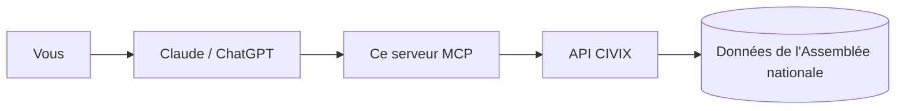

<div align="center">


# MCP Assemblée nationale

**Demandez à Claude, ChatGPT ou Gemini comment ont voté les députés. En français, avec les sources.**

[**Voir la démo en direct**](https://landing-page-mcp-assemblee-national.vercel.app) · [Ajouter à mon assistant](#ajouter-en-2-minutes) · [Exemples de questions](#exemples-de-questions) · [English](#english)

[](https://github.com/Toumi-Elyes/mcp-assemblee-nationale/actions/workflows/ci.yml)

[](LICENSE)
[](https://modelcontextprotocol.io)

</div>

---

## C'est quoi ?

Un connecteur qui branche votre assistant IA sur les **données publiques de l'Assemblée nationale**. L'IA va chercher les vrais chiffres au lieu de répondre de mémoire, et elle cite le lien de chaque scrutin.

- **Gratuit** : pas de compte, pas de clé, pas d'abonnement à ce service.
- **Lecture seule** : l'IA consulte, elle ne modifie rien.
- **Neutre** : les chiffres sont transmis tels quels, sans analyse politique.
- **Sourcé** : chaque réponse renvoie vers la page du scrutin.

Données : [API publique CIVIX](https://www.data.gouv.fr/dataservices/api-publique-civix) (data.gouv.fr), qui republie les données ouvertes de l'Assemblée nationale.

## Ajouter en 2 minutes

Copiez cette adresse, puis collez-la dans votre assistant :

```
https://mcp-assemblee-nationale.vercel.app/mcp
```

Choisissez votre assistant :

<details>
<summary><b>Claude</b> (claude.ai et application) : plan gratuit inclus</summary>

1. Ouvrez [claude.ai](https://claude.ai) et allez dans **Paramètres → Connecteurs**.
2. Cliquez sur **Ajouter un connecteur personnalisé**.
3. Nom : `Assemblée nationale`. URL : collez l'adresse ci-dessus.
4. Cliquez sur **Ajouter**. Aucune connexion n'est demandée.
5. Dans une nouvelle conversation, cliquez sur le bouton **+** (ou l'icône des outils) et vérifiez que **Assemblée nationale** est activé.

Le connecteur est ensuite disponible dans l'application Claude sur ordinateur et sur téléphone.

> Le plan gratuit autorise un connecteur personnalisé, les plans payants en autorisent plusieurs. Sur un compte Team ou Enterprise, c'est l'administrateur qui l'ajoute pour l'organisation.

</details>

<details>
<summary><b>ChatGPT</b> : plans payants, depuis le navigateur</summary>

Il faut un abonnement payant (Plus, Pro, Business, Enterprise ou Edu), et la configuration se fait sur **chatgpt.com**.

1. Ouvrez **Paramètres → Applications et connecteurs → Paramètres avancés** et activez le **Mode développeur**. *Selon la version, ce réglage peut aussi se trouver dans **Paramètres → Sécurité**.*
2. Revenez dans **Applications et connecteurs** et cliquez sur **Créer**.
3. Nom : `Assemblée nationale`. URL du serveur MCP : collez l'adresse ci-dessus. Authentification : **Aucune**.
4. Cochez la case de confiance puis validez.
5. Dans une conversation, cliquez sur **+ → Mode développeur** et activez **Assemblée nationale**.

> ChatGPT affiche « non vérifié par OpenAI » pour toute application ajoutée soi-même : c'est normal. Ce serveur ne fait que lire des données publiques.

</details>

<details>
<summary><b>Gemini</b> : via Gemini CLI</summary>

L'application Gemini (gemini.google.com) ne permet pas, à notre connaissance, d'ajouter son propre serveur MCP. Dès que ce sera possible, la même adresse fonctionnera. En attendant, avec **Gemini CLI** (dans un terminal) :

1. Ouvrez (ou créez) le fichier `~/.gemini/settings.json`.
2. Ajoutez ce bloc :

   ```json
   {
     "mcpServers": {
       "assemblee-nationale": {
         "httpUrl": "https://mcp-assemblee-nationale.vercel.app/mcp"
       }
     }
   }
   ```

3. Relancez Gemini CLI, puis tapez `/mcp` pour vérifier que `assemblee-nationale` est listé.

</details>

<details>
<summary><b>Claude Desktop, Cursor et autres</b> : en local sur votre ordinateur</summary>

La méthode recommandée reste l'adresse ci-dessus : Claude Desktop reprend vos connecteurs claude.ai. Pour faire tourner le serveur chez vous :

1. Installez [uv](https://docs.astral.sh/uv/getting-started/installation/).
2. Collez cette configuration :

   ```json
   {
     "mcpServers": {
       "assemblee-nationale": {
         "command": "uvx",
         "args": ["--from", "git+https://github.com/Toumi-Elyes/mcp-assemblee-nationale", "mcp-assemblee-nationale"]
       }
     }
   }
   ```

3. Où la coller : **Claude Desktop** : Paramètres → Développeur → Modifier la configuration, puis redémarrez l'application. **Cursor** : `~/.cursor/mcp.json`. **Gemini CLI** : `~/.gemini/settings.json`.

</details>

<details>
<summary><b>Ça ne marche pas ?</b></summary>

**Partout**

- Le connecteur doit être **activé dans la conversation en cours** (bouton **+**) : l'ajouter dans les réglages ne suffit pas.
- Demandez explicitement : « Utilise l'outil Assemblée nationale pour… ». Sans cela, l'IA répond parfois de mémoire.
- Les noms des menus changent d'une version à l'autre. Si vous ne trouvez pas **Connecteurs** ou **Applications et connecteurs**, cherchez « connecteur », « MCP » ou « développeur » dans les paramètres.
- Vérifiez l'adresse : elle doit se terminer par `/mcp`, sans espace ni guillemet.

**Claude** : le plan gratuit n'autorise qu'**un seul** connecteur personnalisé, retirez-en un autre pour ajouter celui-ci. Sur un compte d'organisation, seul l'administrateur peut en ajouter.

**ChatGPT** : il faut un plan payant et le **Mode développeur**, depuis le navigateur (pas l'application mobile). Le connecteur n'est actif que dans les conversations où vous l'avez choisi via **+ → Mode développeur**.

**Gemini** : l'application grand public ne prend pas en charge les serveurs MCP personnalisés, à notre connaissance. Utilisez Gemini CLI. Si `/mcp` ne liste rien, vérifiez que le JSON est valide et relancez Gemini CLI.

**En local (uvx)** : installez [uv](https://docs.astral.sh/uv/getting-started/installation/), puis redémarrez l'application pour qu'elle retrouve la commande `uvx`.

</details>

## Exemples de questions

Posez vos questions normalement, en français.

| Vous voulez… | Demandez par exemple |
|---|---|
| Retrouver un vote | « Quels sont les derniers scrutins sur l'immigration ? » |
| Voir le résultat | « Résume-moi le scrutin sur l'aide à mourir, avec le détail par groupe. » |
| Savoir comment un député a voté | « Comment a voté [nom du député] sur la loi de finances ? » |
| Comparer les groupes | « Quels groupes ont voté contre le dernier budget ? » |
| Filtrer un vote | « Quels députés du groupe Écologiste se sont abstenus sur ce scrutin ? » |
| Lire les explications de vote | « Qu'ont déclaré les groupes avant le vote sur [sujet] ? » |
| Connaître les groupes | « Liste les groupes parlementaires et leur nombre de députés. » |
| Identifier un élu | « Qui est le député de la 2e circonscription de l'Ariège ? » |

Astuce : si l'IA ne trouve rien, reformulez avec un mot-clé du titre officiel (« retraites » plutôt que « la réforme de Borne »).

Trois questions prêtes à l'emploi sont aussi proposées dans le menu des prompts de Claude : **Résumer un scrutin**, **Mon député**, **Comparer les groupes**.

### Exemple de réponse

> Illustration : le texte et les valeurs entre crochets sont inventés pour montrer la forme d'une réponse. Les vraies réponses reprennent les données de l'Assemblée.

**Vous** : Comment a voté la députée *[Prénom Nom]* sur *[sujet]* ?

**Assistant** : Sur *[sujet]*, il existe plusieurs scrutins (amendements, articles, vote sur l'ensemble du texte). Voici sa position sur chacun :

| Scrutin | Date | Position |
|---|---|---|
| *[Titre du scrutin 1]* | *[date]* | Pour |
| *[Titre du scrutin 2]* | *[date]* | Contre |

Ce sont les positions enregistrées par l'Assemblée nationale, sans interprétation.
Source : *[lien vers la page du scrutin]*

## Comment ça marche



1. Vous posez une question en français à votre assistant.
2. L'assistant appelle ce serveur pour obtenir les scrutins, députés ou groupes concernés.
3. Le serveur interroge CIVIX et renvoie les chiffres tels quels. L'assistant rédige la réponse et cite la source.

## Ce que l'IA peut faire

Les outils sont rangés par intention. Tous sont en lecture seule.

### Suivre un vote

| Outil | À quoi il sert |
|---|---|
| `rechercher_scrutins` | Trouver les votes sur un thème : date, résultat, titre, identifiant |
| `obtenir_scrutin` | Résultat d'un vote : adopté ou rejeté, pour, contre, abstentions, détail par groupe |
| `votes_scrutin` | Vote de chaque député, filtrable par groupe, position ou nom |
| `declarations_groupes` | Explications de vote publiées par les groupes (souvent aucune) |

<!-- NOUVEAUX OUTILS « Suivre un vote » : votes serrés, chronologie d'un dossier législatif, textes les plus votés (à remplir) -->

### Comprendre une tendance

<!-- NOUVEAUX OUTILS « Comprendre une tendance » : tendances, positions / accord / cohésion des groupes, statistiques de la législature, avec une question d'exemple chacun (à remplir) -->

### Un député, un groupe

| Outil | À quoi il sert |
|---|---|
| `comment_a_vote` | Comment UN député a voté sur un sujet, en une question, avec les sources |
| `rechercher_deputes` | Trouver un député par nom, groupe ou législature |
| `obtenir_depute` | Fiche d'un député : groupe, circonscription, liens officiels |
| `lister_groupes` | Les groupes parlementaires : sigles, effectifs |
| `obtenir_groupe` | Fiche d'un groupe |
| `rechercher` | Chercher sans savoir si c'est un vote, un député ou un groupe |

<!-- NOUVEAUX OUTILS « Un député, un groupe » : synthèse par député, comparaison de députés (à remplir) -->

### Exporter des données

<!-- NOUVEAUX OUTILS « Exporter des données » : exports CSV / JSON (à remplir) -->

### Pour la recherche approfondie de ChatGPT

| Outil | À quoi il sert |
|---|---|
| `search`, `fetch` | Les mêmes données, au format attendu par ChatGPT (deep research) |

## D'où viennent les données

- **Source** : les données ouvertes de l'[Assemblée nationale](https://data.assemblee-nationale.fr), mises à disposition par [CIVIX](https://www.civix.fr), une initiative indépendante, non officielle et neutre ([API sur data.gouv.fr](https://www.data.gouv.fr/dataservices/api-publique-civix)).
- **Licence des données** : Licence Ouverte Etalab 2.0.
- **Neutralité** : ce serveur transmet les chiffres tels quels. Il n'ajoute aucune analyse politique et chaque réponse renvoie vers la source.
- **Fraîcheur** : les réponses sont gardées en mémoire 10 minutes pour ménager l'API CIVIX. Un vote du jour peut mettre un peu de temps à apparaître, selon la mise à jour des données de l'Assemblée.

Ce projet n'est affilié ni à l'Assemblée nationale, ni à CIVIX.

## Vie privée et limites

**Vie privée**

- Le serveur ne reçoit que la requête envoyée par l'IA (par exemple « retraites » ou un nom de député), jamais votre conversation.
- Ces mots-clés sont transmis à l'API CIVIX pour faire la recherche.
- Il n'enregistre pas les conversations, n'utilise aucun cookie et ne demande aucun compte.
- Les réponses de CIVIX sont gardées 10 minutes en mémoire, puis oubliées.
- Votre assistant applique sa propre politique de confidentialité. L'hébergeur (Vercel) peut tenir des journaux techniques d'accès : ce code n'y écrit pas vos questions.

**Limites**

- **Assemblée nationale uniquement** : pas de Sénat, pas de Parlement européen.
- **Fraîcheur** : elle dépend de la publication des données par l'Assemblée et de leur reprise par CIVIX.
- **Disponibilité** : si CIVIX est indisponible, le serveur le dit et il faut réessayer plus tard.
- **Couverture** : seule la législature en cours (la 17e) est bien couverte pour les députés.
- **Plusieurs scrutins par texte** : un texte donne souvent plusieurs votes (amendements, articles, ensemble). Vérifiez toujours lequel est cité.

## Sécurité

Le serveur est en lecture seule et sans compte. Il est protégé ainsi :

- **Budget d'appels** : chaque appel d'outil est limité à 10 appels vers CIVIX (les réponses déjà en cache ne comptent pas). Au-delà, il répond « Demande trop large : précisez le nom, le groupe ou le sujet ».
- **Limitation de débit** : des règles de limitation de débit sont appliquées sur le pare-feu de Vercel.
- **Texte tiers cité et signalé** : les déclarations des groupes sont citées telles quelles et marquées comme contenu tiers, pas comme instructions.
- **Liens autorisés** : seuls les liens https vers `civix.fr`, `assemblee-nationale.fr` et `data.assemblee-nationale.fr` sont repris.

Vous avez trouvé une faille ? Ne l'ouvrez pas en issue publique : suivez [SECURITY.md](SECURITY.md).

## Questions fréquentes

<details>
<summary>Est-ce gratuit ?</summary>

Oui. Le serveur, l'API CIVIX et l'hébergement sont gratuits. Seul l'abonnement à votre assistant (ChatGPT par exemple) peut être payant.

</details>

<details>
<summary>Est-ce officiel ?</summary>

Non. C'est un projet personnel, indépendant de l'Assemblée nationale. Les données viennent de l'Assemblée, via CIVIX, qui est lui aussi indépendant.

</details>

<details>
<summary>Mes conversations sont-elles enregistrées ?</summary>

Le serveur ne reçoit que la recherche envoyée par l'IA, jamais votre conversation. Il ne garde aucun historique et n'utilise aucun cookie. Voir [Vie privée et limites](#vie-privée-et-limites).

</details>

<details>
<summary>L'IA dit qu'elle n'a pas accès à l'outil</summary>

Vérifiez que le connecteur est activé dans la conversation (bouton **+**), puis demandez explicitement : « Utilise l'outil Assemblée nationale pour… ».

</details>

<details>
<summary>J'ai un message d'erreur</summary>

« Le service CIVIX est momentanément indisponible » : réessayez dans quelques minutes. « Aucune donnée trouvée » : l'identifiant ou le nom est inconnu, reformulez. « Demande trop large » : précisez le nom, le groupe ou le sujet.

</details>

<details>
<summary>L'IA s'est trompée</summary>

Ouvrez le lien « Source » de la réponse : il mène à la page du scrutin. Les chiffres viennent du serveur, mais c'est l'IA qui rédige la phrase : elle peut mal les résumer.

</details>

<details>
<summary>Comment signaler une erreur ?</summary>

- *Les données elles-mêmes semblent fausses* (vote ou député mal enregistré) : signalez-le à [CIVIX](https://www.civix.fr), ou à l'Assemblée nationale pour la donnée d'origine.
- *Le serveur se comporte mal* (outil en erreur, réponse mal formée) : [ouvrez une issue](https://github.com/Toumi-Elyes/mcp-assemblee-nationale/issues) en indiquant votre question et la réponse obtenue.
- *Une faille de sécurité* : voir [SECURITY.md](SECURITY.md).

</details>

<details>
<summary>Et le Sénat ?</summary>

Pas pour l'instant : l'API CIVIX couvre uniquement l'Assemblée nationale.

</details>

## Pour les développeurs

Serveur [MCP](https://modelcontextprotocol.io) en Python, construit avec [FastMCP](https://gofastmcp.com) 4. Les réponses de l'API CIVIX sont validées par des modèles [Pydantic](https://docs.pydantic.dev) v2, les appels passent par [httpx](https://www.python-httpx.org), et les dépendances sont gérées avec [Poetry](https://python-poetry.org). Il faut Python 3.14 ou plus récent (développé en 3.15).

<details>
<summary><b>Lancer en local et vérifier</b></summary>

```bash
poetry install
poetry run mcp-assemblee-nationale                    # stdio
poetry run mcp-assemblee-nationale --http --port 8000 # HTTP sur http://127.0.0.1:8000/mcp
npx @modelcontextprotocol/inspector poetry run mcp-assemblee-nationale  # tester les outils
```

Options : `--http` (HTTP streamable sans état, chemin `/mcp`), `--host` (défaut `127.0.0.1`, ou variable `HOST`), `--port` (défaut `8000`, ou variable `PORT`). Sans `--http`, le serveur parle en stdio.

```bash
poetry run ruff check . && poetry run ruff format --check .
poetry run mypy src tests api
poetry run pytest                          # tests hors ligne, sur des réponses CIVIX enregistrées
CIVIX_LIVE=1 poetry run pytest tests/live  # tests contre la vraie API CIVIX
```

Les réponses enregistrées sont dans `tests/fixtures/`, avec la spécification OpenAPI de CIVIX (`civix-openapi.json`).

</details>

<details>
<summary><b>Architecture</b></summary>

```
src/assemblee_mcp/
├── civix/
│   ├── client.py     client HTTP async (caches TTL, une nouvelle tentative, erreurs en français)
│   ├── budget.py     budget d'appels CIVIX par appel d'outil
│   ├── models.py     modèles Pydantic des réponses CIVIX
│   ├── lookup.py     recherches composées (députés, groupes, sigles)
│   └── errors.py     erreurs lisibles pour l'utilisateur
├── tools/
│   ├── recherche.py  rechercher
│   ├── scrutins.py   rechercher_scrutins, obtenir_scrutin, votes_scrutin, declarations_groupes
│   ├── deputes.py    rechercher_deputes, obtenir_depute, comment_a_vote
│   ├── groupes.py    lister_groupes, obtenir_groupe
│   ├── chatgpt.py    search, fetch (format ChatGPT)
│   └── common.py     types de paramètres, annotations lecture seule, budget, conversion d'erreurs
├── formatting.py     mise en forme des réponses en français
├── links.py          liens vers CIVIX et l'Assemblée nationale
├── urls.py           liste des sites autorisés pour les liens repris
├── textutils.py      comparaison de textes sans accents ni casse
├── prompts.py        questions prêtes à l'emploi
├── config.py         réglages (variables d'environnement)
├── server.py         assemble le serveur (`mcp`) et la route /health
└── __main__.py       lancement en stdio ou en HTTP
api/index.py          point d'entrée Vercel (ASGI)
web/                  page de démo (Next.js)
```

</details>

<details>
<summary><b>Modèles Pydantic</b></summary>

Fichier `src/assemblee_mcp/civix/models.py`. Tous héritent de `CivixModel` : champs inconnus ignorés, modèles immuables.

- **Enveloppe générique** `CivixResponse[AttributesT]` : `answer`, `summary`, `canonical_url`, `meta` (avec `Pagination`), `source`, `citation` et `data` (`Data[AttributesT]`, dont le bloc `attributes`).
- **Modèles par point d'accès**, en alias : `ScrutinListResponse`, `ScrutinResponse`, `ScrutinVotesResponse`, `StatementsResponse`, `DeputeListResponse`, `DeputeDetailResponse`, `GroupeListResponse`, `GroupeDetailResponse`, `SearchResponse`.
- **Objets métier** : `ScrutinSummary`, `ScrutinDetail`, `Scrutin`, `Vote`, `VoteCounts`, `GroupVoteCounts`, `Depute`, `Groupe`, `GroupeStatement`, et les résultats de recherche (`DeputeSearchHit`, `ScrutinSearchHit`, `GroupeSearchHit`, `DossierSearchHit`).
- **`Position`** : `StrEnum` (`pour`, `contre`, `abstention`, `non_votant`, `unknown`). Toute valeur inconnue devient `unknown`.

Une réponse qui ne respecte pas le modèle devient un message d'erreur lisible, jamais une trace d'appel.

</details>

<details>
<summary><b>Référence des outils (paramètres)</b></summary>

Tous les outils sont annotés `readOnlyHint`, `idempotentHint` et `openWorldHint` à vrai, `destructiveHint` à faux. Ils renvoient du markdown français, sauf `search` et `fetch` qui renvoient du JSON. Une erreur CIVIX devient une `ToolError` au message clair. Chaque appel d'outil dispose d'un budget de 10 appels réseau vers CIVIX. Taille de page par défaut : 10.

Types partagés (`tools/common.py`) : `page` entier de 1 à 500 (défaut `1`) ; `legislature` entier de 1 à 30 ; `uid` de scrutin : 3 à 64 caractères `[A-Za-z0-9_-]` ; `groupe` / `abbr` : sigle de 1 à 32 caractères ; `position` : `pour`, `contre`, `abstention` ou `non_votant`.

| Outil | Paramètres (type, défaut) | Rôle |
|---|---|---|
| `rechercher` | `requete: str` (2 à 200 car., requis), `page: int = 1` | Recherche globale ; jusqu'à 8 résultats par catégorie |
| `rechercher_scrutins` | `mots_cles: str \| None = None` (max 200), `legislature: int \| None = None`, `page: int = 1` | Scrutins par sujet ; sans mots-clés, les plus récents |
| `obtenir_scrutin` | `uid: str` (requis) | Détail et décomptes, global et par groupe |
| `votes_scrutin` | `uid: str` (requis), `groupe: str \| None = None`, `position: "pour" \| "contre" \| "abstention" \| "non_votant" \| None = None`, `nom: str \| None = None` (max 100) | Votes individuels ; liste limitée à 60 noms, totaux officiels toujours indiqués |
| `declarations_groupes` | `uid: str` (requis) | Explications de vote publiées par les groupes |
| `rechercher_deputes` | `nom: str \| None = None` (max 100), `groupe: str \| None = None`, `legislature: int \| None = None`, `page: int = 1` | Députés par nom, groupe ou législature |
| `obtenir_depute` | `uid: str` (3 à 32 car. alphanumériques, requis) | Fiche d'un député |
| `comment_a_vote` | `depute: str` (2 à 100 car., requis), `sujet: str \| None = None` (max 200), `scrutin_uid: str \| None = None` | Position d'un député ; exactement un de `sujet` ou `scrutin_uid` ; jusqu'à 5 scrutins ; nom ambigu : jusqu'à 10 candidats |
| `lister_groupes` | aucun | Groupes, sigles et effectifs |
| `obtenir_groupe` | `abbr: str` (requis) | Fiche d'un groupe |
| `search` | `query: str` (2 à 200 car., requis) | JSON `{"results": [{"id", "title", "url"}]}` ; ids `scrutin:<uid>`, `depute:<uid>`, `groupe:<sigle>` |
| `fetch` | `id: str` (3 à 100 car., requis) | JSON `{"id", "title", "text", "url", "metadata"}` pour un id renvoyé par `search` |

<!-- NOUVEAUX OUTILS : ajouter ici une ligne par outil (nom, paramètres, défauts, rôle) -->

Prompts MCP (`src/assemblee_mcp/prompts.py`) :

| Prompt | Paramètre | Enchaînement demandé à l'IA |
|---|---|---|
| `resumer_scrutin` | `sujet: str` | `rechercher_scrutins` puis `obtenir_scrutin` |
| `mon_depute` | `nom: str` | `rechercher_deputes` puis `obtenir_depute`, puis propose `comment_a_vote` |
| `comparer_groupes` | `sujet: str` | `rechercher_scrutins`, `obtenir_scrutin` et `declarations_groupes` |

Le serveur expose aussi `GET /health`, qui répond `{"status": "ok"}`.

</details>

<details>
<summary><b>Réglages (variables d'environnement)</b></summary>

| Variable | Défaut | Rôle |
|---|---|---|
| `CIVIX_BASE_URL` | `https://www.civix.fr/api/v1` | Adresse de l'API |
| `CIVIX_TIMEOUT` | `10` | Délai max d'un appel, en secondes |
| `CIVIX_CACHE_TTL` | `600` | Durée du cache, en secondes |
| `CIVIX_CACHE_MAX_ENTRIES` | `500` | Nombre max de réponses gardées en cache |
| `CIVIX_USER_AGENT` | `mcp-assemblee-nationale (+https://github.com/Toumi-Elyes/mcp-assemblee-nationale)` | En-tête `User-Agent` envoyé à CIVIX |
| `HOST` | `127.0.0.1` | Hôte d'écoute en mode `--http` |
| `PORT` | `8000` | Port d'écoute en mode `--http` |

En cas d'échec réseau ou d'erreur 5xx, le client refait un seul essai après 0,3 s. Il limite aussi les appels simultanés vers CIVIX (4 au maximum).

</details>

<details>
<summary><b>Héberger votre propre copie</b></summary>

Le serveur public tourne sur [Vercel](https://vercel.com) (région de Paris, `cdg1`), gratuitement (plan Hobby) et sans compte à créer pour les utilisateurs. Le dépôt contient déjà tout le nécessaire : `api/index.py` expose l'application ASGI sur `/mcp` et `vercel.json` y redirige toutes les requêtes.

1. Forkez ce dépôt et importez-le dans Vercel (**Add New → Project**). Gardez la racine du dépôt comme dossier racine et laissez le framework sur **Other**.
2. Déployez. Vercel lit les dépendances et la version de Python dans `pyproject.toml`.
3. Votre adresse à partager est `https://<votre-projet>.vercel.app/mcp`. Vérifiez avec `https://<votre-projet>.vercel.app/health`.
4. Ajoutez une limitation de débit sur le pare-feu de votre projet : le code limite le nombre d'appels vers CIVIX par demande, pas le nombre de demandes.

Chaque push sur `main` redéploie le serveur. Pour déployer en ligne de commande, utilisez un token Vercel dans la variable `VERCEL_TOKEN`, rangée dans un fichier `.env` ignoré par git.

Pour un autre hébergeur (Render, Fly.io, un VPS…) :

```bash
mcp-assemblee-nationale --http --host 0.0.0.0 --port $PORT
```

</details>

## Contribuer

Les issues et pull requests sont les bienvenues : nouvel outil, meilleure formulation des réponses, correction. La branche `main` est protégée : toute contribution passe par une pull request dont la CI est verte. Voir [CONTRIBUTING.md](CONTRIBUTING.md).

Une règle : **des faits sourcés, aucune interprétation politique**.

## Crédits et licences

- Données : [Assemblée nationale](https://data.assemblee-nationale.fr), en open data, sous Licence Ouverte Etalab 2.0.
- API : [CIVIX](https://www.civix.fr), par Arnaud Bergeret, référencée sur [data.gouv.fr](https://www.data.gouv.fr/dataservices/api-publique-civix). CIVIX est une initiative indépendante et non officielle.
- Outils : [FastMCP](https://gofastmcp.com), [Pydantic](https://docs.pydantic.dev), [httpx](https://www.python-httpx.org).
- Code : licence [MIT](LICENSE), © Elyes Toumi. Données : Licence Ouverte Etalab 2.0.

## English

An [MCP](https://modelcontextprotocol.io) server that lets Claude, ChatGPT or Gemini answer questions about **French National Assembly votes** (scrutins, individual votes by deputy, parliamentary groups), using the open [CIVIX API](https://www.data.gouv.fr/dataservices/api-publique-civix). Free, no account, no API key, read-only, every answer links to its source.

- **Live demo**: [landing page](https://landing-page-mcp-assemblee-national.vercel.app)
- **Remote URL** (Claude custom connectors, ChatGPT developer mode, Gemini CLI `httpUrl`): `https://mcp-assemblee-nationale.vercel.app/mcp`
- **Local**: `uvx --from git+https://github.com/Toumi-Elyes/mcp-assemblee-nationale mcp-assemblee-nationale` (stdio), or `--http` for streamable HTTP.
- **Stack**: Python 3.14+, FastMCP 4, Pydantic v2 models, httpx, Poetry, hosted on Vercel (Paris).
- **Scope**: National Assembly only (no Senate). Tool outputs are in French, since the underlying data is French.
- **Privacy**: the server only receives the tool query, keeps no conversation history, sets no cookies; CIVIX responses are cached for 10 minutes.
- **Security**: per-tool CIVIX call budget, rate limiting at the hosting firewall, third-party text quoted and marked, links allow-listed. Report vulnerabilities via [SECURITY.md](SECURITY.md).
- **Not official**: independent project, not affiliated with the Assemblée nationale or CIVIX.
- **Licence**: code under [MIT](LICENSE); data under Licence Ouverte Etalab 2.0 (Assemblée nationale, via CIVIX).
